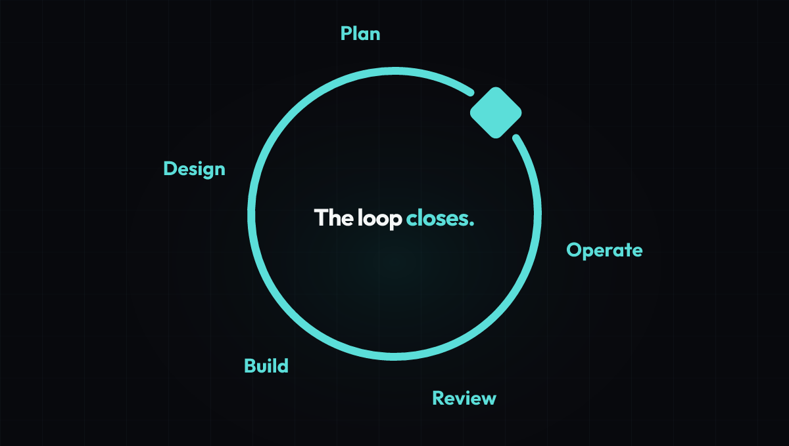
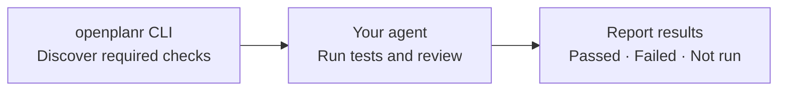
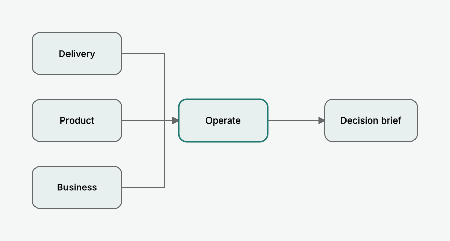

<p align="center">
  <picture>
    <source media="(prefers-color-scheme: dark)" srcset="docs/assets/brand/openplanr-lockup-on-dark.png">
    
  </picture>
</p>

<h3 align="center">Close the loop from intent to delivery.</h3>

<p align="center">
  Your agent writes the code. OpenPlanr is the open harness around it.<br>
  Plans as files in your repo, checks before you merge, and a record of what shipped.<br>
  25+ skills for Claude Code, Codex, and Cursor. Install the plugin or pick the skills you need.
</p>

<p align="center"><strong>Plan. Ship and verify. Operate.</strong></p>

<p align="center">
  <a href="https://www.npmjs.com/package/openplanr"></a>
  <a href="https://www.npmjs.com/package/openplanr"></a>
  <a href="https://github.com/openplanr/OpenPlanr/actions/workflows/ci.yml"></a>
  <a href="packages/cli/package.json"></a>
  <a href="LICENSE"></a>
</p>

<p align="center">
  <a href="https://openplanr.dev/docs">Docs</a> ·
  <a href="docs/getting-started.md">Getting started</a> ·
  <a href="docs/generated/skills.md">Skills</a> ·
  <a href="packages/cli/docs/CLI.md">CLI reference</a> ·
  <a href="docs/architecture/README.md">Architecture</a> ·
  <a href="SUPPORT.md">Support</a>
</p>

<p align="center">
  <a href="docs/diagrams/closing-loop/closing-loop.svg">
    
  </a>
</p>

---

## What the harness adds

OpenPlanr gives your coding agent shared context, repeatable workflows, and a way to
check the work against the request. Your agent uses its own model, tools, and permissions.

- **Context that stays with the code.** Keep plans and decisions beside
  the code. Initialized projects store stories and tasks under `.planr/` as reviewable files.
- **Skills for the work at hand.** Specify a feature, explore a design, implement a change,
  investigate a bug, or review what shipped. Start with the skill your request needs.
- **Checks with clear results.** The CLI validates planning structure and discovers the
  repository checks relevant to a change. Your agent runs those checks and reports what
  passed, failed, or remains unverified.

OpenPlanr is available as a plugin and as individual skills. Install it through your
coding agent's marketplace or normal skill installer. The companion `openplanr` CLI
provides utilities for workflows that need them.

## Quick start

### Install the plugin or individual skills

**Claude Code marketplace**

```text
/plugin marketplace add openplanr/marketplace
/plugin install planr@openplanr
```

This installs the `planr` plugin. Restart Claude Code, then invoke its skills as
`/planr:<skill>`.

**Individual skills for Claude Code, Codex, Cursor, and other compatible hosts**

Use the standard [skills installer](https://github.com/vercel-labs/skills):

```bash
npx skills add openplanr/OpenPlanr
```

Run this in your terminal to choose the skills and installation scope. The installer
detects available coding agents and asks you to choose when needed. No flags are required.
The [getting started guide](docs/getting-started.md) covers optional flags and
CLI-managed plugin installation.

### Use a skill

Start with the work you need:

| You want to… | Skill |
| --- | --- |
| Shape an unclear feature | `spec` |
| Explore a product interface | `design` |
| Implement a clear change | `ship` |
| Diagnose a bug | `investigate` |
| Review the product and decide what is next | `operate` |

For example, with the Claude Code plugin:

```text
/planr:ship "Add keyboard navigation to the settings menu"
```

Individual skills retain their installed names, such as `planr-ship`; select that skill
in your host. A direct change does not require a specification. Use `plan` when the
change needs decomposition, and `spec` when requirements need clarification.

### Add CLI utilities when a workflow needs them

The CLI supports planning validation, diagram rendering, local studios, diagnostics,
and integrations. Install it alongside your skills for those capabilities:

```bash
npm install -g openplanr
```

The OpenPlanr CLI requires a supported Node.js version; see
[package metadata](packages/cli/package.json). It can also install and manage the host
integration for you:

<details>
<summary>CLI-managed installation</summary>

Run `openplanr setup` without flags for guided host, scope, and discovery-mode choices.
For scripts, select the host explicitly:

| Host | Setup | Invoke a skill |
| --- | --- | --- |
| Claude Code | `openplanr setup --runtime claude --scope user` | `/planr:<skill>` |
| Codex | `openplanr setup --runtime codex --scope user --skill-mode unified-plugin` | `$planr:<skill>` |
| Cursor | `openplanr setup --runtime cursor --scope project` | Mention the `planr-<skill>` rule |

Run project-scoped setup from your project directory and restart your coding agent
after setup. Choose one installation method per host to avoid duplicate skill entries.

</details>

To enable structured planning in a project:

```bash
cd your-project
openplanr init
```

## Plan. Ship and verify. Operate.

The harness connects three kinds of work. Start where the request needs attention.

### Plan

Shape intent, explore designs, and make the next work clear. Keep decisions and
plans beside the code; use specifications, stories, and tasks when that structure helps.

### Ship and verify

Implement the requested change, run the relevant checks, and review
the result. Report what changed, what passed, and what remains unverified. `land` assesses
readiness; `release` prepares versioning and release notes.

The CLI can help discover what to run; your agent executes the checks and reports the results.



### Operate

Review product, delivery, and operating evidence across seven perspectives.
Turn those findings into a decision and action brief that informs the next work.


For example, bring the delivery, product, and business evidence relevant to your review:

<p align="center">
  <a href="docs/diagrams/operating-review/operating-review.svg">
    
  </a>
</p>

Supply the sources the review needs. Recommendations cite evidence or name the missing
information; proposed actions remain yours to assess.

These workflows are separately invoked. They do not form an automatically running pipeline;
merging, publishing, and deployment require separate authorization.

## Skills

| Work | Skills |
| --- | --- |
| Specify and plan | `spec`, `plan`, `plan-review`, `sprint` |
| Design and visualize | `design`, `design-loop`, `design-review`, `diagram`, `artifact` |
| Implement and investigate | `ship`, `investigate` |
| Delegate explicitly | `delegate` |
| Verify and prepare delivery | `browser-qa`, `land`, `release` |
| Inspect and maintain | `status`, `sync`, `dashboard`, `doctor` |
| Connect and communicate | `connect`, `share` |
| Review operations | `operate`, `ceo-review`, `cto-review`, `cpo-review`, `cmo-review`, `coo-review`, `challenger-review`, `chair-review` |
| Find the right workflow | `openplanr` |

Plugin installations use `/planr:<skill>` in Claude Code and `$planr:<skill>` in Codex.
Individual skills use their installed names; CLI-managed Cursor rules use `planr-<skill>`.
The [skill catalog](docs/generated/skills.md) describes every skill and when to use it.
The optional `delegate` workflow hands an explicitly requested implementation to another
coding agent; the other workflows use the current host.

The `diagram` skill creates architecture, process, sequence, data, and other diagrams.
The CLI renders and checks their source and output files locally. The operating-review
diagram above is generated from [this editable document](docs/diagrams/operating-review/operating-review.planr-diagram.json).
See [diagram authoring](docs/diagrams/authoring.md) for supported formats and verification.

## Optional connections

Keep GitHub Issues or Linear in step with repository plans, or use the connectors installed
in your agent for other services. Connected workflows require the relevant authentication;
OpenPlanr does not bundle your host's connectors. See [connections](docs/connections.md)
for setup, credentials, and data handling.

## Repository and documentation

This MIT-licensed monorepo contains the skills, CLI, delivery pipeline, and Protocol contracts.
Start here:

| Goal | Where to go |
| --- | --- |
| Use OpenPlanr | [Getting started](docs/getting-started.md), [CLI reference](packages/cli/docs/CLI.md), [troubleshooting](packages/cli/docs/TROUBLESHOOTING.md) |
| Author skills or diagrams | [Skill authoring](docs/skills/authoring.md), [diagram authoring](docs/diagrams/authoring.md) |
| Contribute code | [Contributing](CONTRIBUTING.md), [architecture and workspace ownership](docs/architecture/README.md), [working from a checkout](docs/contributing/dogfooding.md) |
| Integrate with the contracts | [Protocol](packages/protocol/README.md), [pipeline](packages/pipeline/README.md), [host matrix](docs/skills/host-matrix.md) |
| Maintain a release | [Release process](docs/RELEASING.md), [release verification](docs/PROVENANCE.md) |

## Community and license

Try OpenPlanr on a real feature and share your feedback in
[Discussions](https://github.com/openplanr/OpenPlanr/discussions).
Report bugs through the [issue forms](https://github.com/openplanr/OpenPlanr/issues/new/choose);
[SUPPORT.md](SUPPORT.md) explains what to include. Security reports follow
[SECURITY.md](SECURITY.md), and participation follows the [code of conduct](CODE_OF_CONDUCT.md).

OpenPlanr is [MIT licensed](LICENSE). The name and logo are covered by the
[trademark policy](TRADEMARKS.md). [COMMERCIAL.md](COMMERCIAL.md) describes the boundary
between this repository and the hosted service.

Founded and maintained by Asem Abdo
([GitHub](https://github.com/AsemDevs) · [LinkedIn](https://www.linkedin.com/in/asemabdo/)).
